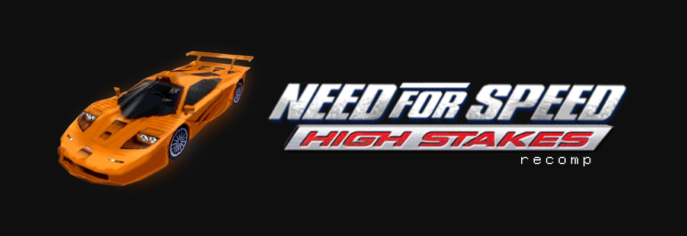

<p align="center">
  
</p>

# Need for Speed: High Stakes (PSX) – Recompiled

A static recompilation of the PlayStation version of Need for Speed: High Stakes (US release, SLUS-00826) to C#,
using a forked [RecompOne](https://github.com/mayhemdotcpp/RecompOne). The game's MIPS code is translated into C# 
ahead of time and runs natively on Windows and Linux, with RecompOne providing the PlayStation 
hardware and the window, sound and input.

The original game, enhanced with:

- 16:9 widescreen, by widening the game's own camera rather than stretching the picture
- PGXP for steadier polygons and textures (on by default)
- 2 small C# mods that load at startup (unlock all cars, unlock all tracks)
- texture replacement packs, see [packs/README.md](packs/README.md)

This repository contains no game data. You need your own copy of the game.

## What you need

- a disc image of Need for Speed: High Stakes, US version (SLUS-00826), as .cue + .bin
- [.NET 10 SDK](https://dotnet.microsoft.com/download)
- Python 3
- git
- on Linux: [PowerShell 7](https://learn.microsoft.com/powershell/scripting/install/installing-powershell-on-linux)
  (`pwsh`), since the build script is a PowerShell script

The project is built on the USA version, using a .bin image with the SHA-1 hash `72E5FC9254903797A08D56BABBEF689E30514FB8`. 
To check your image, run `Get-FileHash -Algorithm SHA1 disc\*.bin` in PowerShell or `sha1sum disc/*.bin` on Linux.

## Building

```
git clone --recurse-submodules <repo url>
```

If you cloned without `--recurse-submodules`, the build script fetches the submodule for you.

Put the game's .cue and .bin in `disc\`. The file names don't matter. The build reads the game's code from it 
and copies the .cue and .bin to `build\<runtime>\disc\`.

### Windows

```
.\build.ps1
```

The script recompiles the game into `generated\`, applies the patches and publishes the result to `build\win-x64\`.

The script compiles through `csc.cmd` instead of the normal C# compiler, because `csc.exe` crashes on some older
Windows builds. `csc.cmd` contains the path to the .NET SDK (`C:\Program Files\dotnet\sdk\10.0.401\...`). If you
have a different SDK version installed, change the version in that path to match `dotnet --version`.

### Linux

```
pwsh ./build.ps1 -Runtime linux-x64
```

The output goes to `build/linux-x64/`. The same command also works from Windows, so you can build the Linux
version there and copy it over.

### Build options

| Option | What it does |
|---|---|
| `-Runtime <rid>` | target platform: `win-x64` (default) or `linux-x64` |
| `-Recompiler` | rebuild the recompiler |

## Running

Start `nfs4.exe` (or `nfs4` on Linux) in `build\<runtime>\`. The game uses the disc the build copied to its
`disc\` folder. If it can't find one there, it asks you to pick a .cue or .chd.

Settings, key bindings, memory cards (`carda.sav`, `cardb.sav`) and `interface.ini` are kept in the folder you
start the game from. F1 shows the menu bar, F11 toggles fullscreen.

### Keyboard controls

| PlayStation | Keys |
|---|---|
| D-pad | arrow keys, or A / D for left and right |
| Cross (accelerate, confirm) | W or Enter |
| Square (brake) | S |
| Circle | Space |
| Triangle (back) | C or Backspace |
| L1 / R1 | Q / E |
| L2 / R2 | Z / X |
| Start (pause) | Escape |
| Select | Right Shift |

You can change them under Settings > Input. The `+` next to a binding adds a second key. Gamepads work too.

### Environment variables

| Variable | Effect |
|---|---|
| `NFS4_WIDE=0` | turns widescreen off and keeps the original 4:3 |
| `NFS4_TRACE=1` | logs CD and SDK calls to the console |
| `NFS4_INPUT` | presses buttons at set times, for testing. `12:cross:150,15:down:150` presses Cross 12 seconds after launch for 150 ms, then Down at 15 seconds |

## Project layout

| Path | Contents |
|---|---|
| `config/` | recompiler config and function maps for the game's executables |
| `tools/apply_patches.py` | applies the widescreen and PGXP texture fixes to the generated code |
| `patches/` | C# switches and runtime patches for the game |
| `mods/` | mods that are copied next to the executable and compiled at startup |
| `packs/` | texture packs |
| `external/RecompOne/` | the RecompOne recompiler and runtime (git submodule) |
| `generated/` | the recompiled game, created by the build (git ignored) |

## Credits

- [RecompOne](https://github.com/BlackLabelHQ/RecompOne) for the recompiler and runtime
- the NFSHS-PSX decompilation project, whose function names and boundaries went into the function maps

Need for Speed: High Stakes is a trademark of Electronic Arts. This project is not affiliated with or endorsed by
Electronic Arts.
